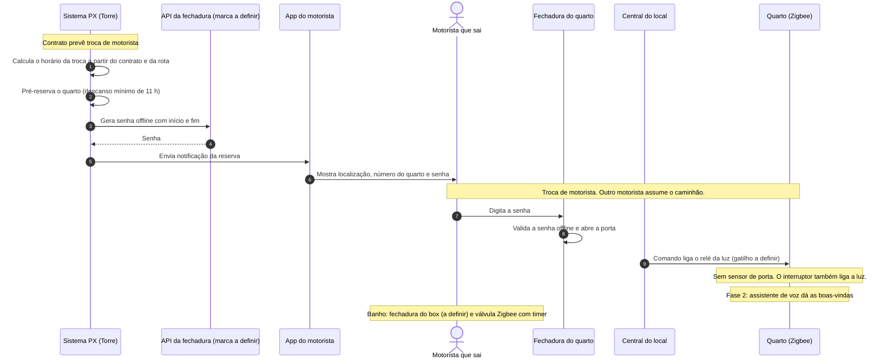

# Quarto PX

Quarto inteligente de descanso para motoristas PX.

O sistema PX pré-reserva o quarto a partir do contrato do motorista. O motorista recebe no app a senha da fechadura e as informações do quarto. No quarto, a luz acende automaticamente. Na fase 2, um assistente de voz dá as boas-vindas ao motorista.

O quarto tem só o dormitório. O banheiro fica fora do quarto e é comunitário. Cada box de chuveiro tem uma fechadura e uma válvula com timer. O motorista tem direito a um banho grátis. Para outro banho, o motorista paga.

Escala: o número de quartos aumentou muito em relação aos cerca de 20 quartos iniciais. O valor novo está a confirmar.

## O quarto

Cada quarto mede cerca de 2 m × 2,5 m e tem uma cama de solteiro e um ar-condicionado. A janela fica numa parede de 2 m, com o ar-condicionado sobre a janela. A porta, com a fechadura, fica na parede oposta de 2 m.


## O banheiro comunitário

O banheiro mede cerca de 6 m × 2,4 m e tem 4 boxes de chuveiro e 3 boxes de vaso, todos de 1,2 m × 0,85 m. Cada box de chuveiro tem uma fechadura (a definir) e uma válvula Zigbee com timer. O banheiro tem um detector de fumaça no teto do corredor.



## Arquitetura

Cada local tem uma central (mini PC) com Zigbee2MQTT. Os dispositivos dos quartos e do banheiro são Zigbee comerciais, em mesh: relé de parede, detector de fumaça e válvula do chuveiro. A fechadura do quarto fica fora da rede e valida a senha offline. O assistente de voz é uma camada separada, por Wi-Fi, na fase 2.

```
Torre PX (nuvem) ──► Central do local (mini PC: MQTT, Zigbee2MQTT, orquestrador)
                          │
                     coordenador Zigbee ── mesh: quartos e banheiro
Fechadura do quarto: fora da rede, senha offline por algoritmo
```

A decisão está na [ADR 0001](ADRs/0001-central-zigbee-por-local.md). O detalhe está em [`hardware/hub-automacao.md`](hardware/hub-automacao.md).


## Contexto da operação

A operação usa troca de motoristas em viagens longas.

- O trajeto é longo e a viagem demora muito.
- A cada cerca de 12 h de direção, o motorista precisa descansar por, no mínimo, 11 h.
- O caminhão não pode ficar parado 11 h. Por isso, outro motorista assume o caminhão.
- O motorista que sai fica hospedado no quarto PX durante o descanso.

O sistema PX conhece o contrato e a rota. Por isso, o sistema PX pré-reserva o quarto antes da troca. Depois da pré-reserva, começa o fluxo de uso.

## Fluxo de uso (proposta)

Este fluxo é uma proposta. Os passos marcados "a confirmar" dependem da investigação do hardware.



## Fase atual: escolha do hardware

O hardware define o resto do projeto. A investigação está no painel [`hardware/`](hardware/README.md).

| Peça | Situação |
|---|---|
| Central de automação | Decidida a direção: mini PC por local, Zigbee2MQTT e dispositivos Zigbee em mesh. Produtos a escolher. Veja a [ADR 0001](ADRs/0001-central-zigbee-por-local.md). |
| Fechadura do quarto | Obrigatória. Senha com início e fim, validada offline por algoritmo. Marca a escolher. Veja [`hardware/fechadura.md`](hardware/fechadura.md). |
| Luz | 1 ponto de luz e 1 interruptor por quarto. Relé Zigbee na caixa da parede. A luz acende pelo interruptor e pelo comando da central ao relé. O gatilho do comando está a definir. |
| Ar-condicionado | 1 por quarto, sobre a janela. Por enquanto, o motorista usa o controle do aparelho. |
| Detector de fumaça | Obrigatório, 1 por quarto e 1 no banheiro. Alarme local, sem depender de rede. A central recebe o sinal do alarme. Veja [`hardware/detector-fumaca.md`](hardware/detector-fumaca.md). |
| Banheiro comunitário | 3 boxes de vaso e 4 boxes de chuveiro. Fechadura por box de chuveiro (a definir) e válvula Zigbee com timer. Um banho grátis e banhos extras pagos. Veja [`hardware/banheiro.md`](hardware/banheiro.md). |
| Assistente de voz | Fase 2. Satélite ESP32-S3 por Wi-Fi, com STT e TTS na central. Veja [`hardware/assistente.md`](hardware/assistente.md). |
| Reserva | O sistema PX pré-reserva o quarto a partir do contrato do motorista. Proposta complementar: plataforma interna com login pelo Keycloak. Veja [`docs/reserva.md`](docs/reserva.md). |

## Futuro

- O motorista reserva um quarto por conta própria e paga pela reserva.

## Estrutura do repo

| Pasta | Conteúdo |
|---|---|
| [`hardware/`](hardware/README.md) | Painel vivo do hardware, um documento por subsistema e os diagramas |
| [`ADRs/`](ADRs/) | Decisões de arquitetura fechadas |
| [`contracts/`](contracts/) | Contratos entre sistemas, por exemplo Torre ↔ central do local e Torre ↔ API da fechadura (vazia por enquanto) |
| [`docs/`](docs/) | Documentação geral do projeto, por exemplo a [reserva](docs/reserva.md) |

## Como contribuir com a documentação

- A decisão fechada vira uma ADR em `ADRs/`, e o estado do subsistema muda para 🟢 no painel.
- Os diagramas SVG saem de `hardware/diagramas/gerar.py`. Veja [`hardware/diagramas/README.md`](hardware/diagramas/README.md).
- O diagrama de fluxo de uso é Mermaid. O GitHub mostra o diagrama direto no README. Para mudar o fluxo, edite o bloco `mermaid`.
