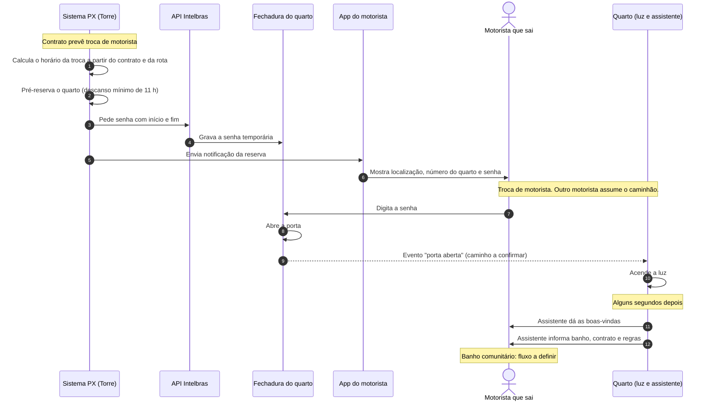

# Quarto PX

Quarto inteligente de descanso para motoristas PX.

O sistema PX pré-reserva o quarto a partir do contrato do motorista. O motorista recebe no app a senha da fechadura e as informações do quarto. No quarto, a luz acende automaticamente e um assistente de voz dá as boas-vindas ao motorista.

O quarto tem só o dormitório. O banheiro fica fora do quarto e é comunitário. O banheiro também tem controle de acesso. O motorista tem direito a um banho grátis. Para outro banho, o motorista paga.

Escala inicial: cerca de 20 quartos.

> **Atenção:** os diagramas SVG ainda mostram a versão anterior da arquitetura. Eles serão atualizados em `hardware/diagramas/gerar.py`.

## Contexto da operação

A operação usa troca de motoristas em viagens longas.

- O trajeto é longo e a viagem demora muito.
- A cada cerca de 12 h de direção, o motorista precisa descansar por, no mínimo, 11 h.
- O caminhão não pode ficar parado 11 h. Por isso, outro motorista assume o caminhão.
- O motorista que sai fica hospedado no quarto PX durante o descanso.

O sistema PX conhece o contrato e a rota. Por isso, o sistema PX pré-reserva o quarto antes da troca. Depois da pré-reserva, começa o fluxo de uso.

## Fluxo de uso (proposta)

Este fluxo é uma proposta. Os passos marcados "a confirmar" dependem da investigação do hardware.

## Fase atual: escolha do hardware

O hardware define o resto do projeto. A investigação está no painel [`hardware/`](hardware/README.md).

| Peça | Situação |
|---|---|
| Hub de automação | Em avaliação: hub Intelbras MCA, controlado pela API de integração da Intelbras. A Alexa não é mais uma opção. |
| Fechadura do quarto | Obrigatória. A Torre provisiona a senha pela API Intelbras, para a data e o horário da reserva. |
| Assistente de voz | Desenvolvimento interno, provavelmente. Dá as boas-vindas e informa o motorista. |
| Banheiro comunitário | Fora do quarto, com controle de acesso. Um banho grátis e banhos extras pagos. Fluxo a definir. |
| Luz | 1 ponto de luz e 1 interruptor por quarto. A luz acende quando o motorista entra. |
| Reserva | O sistema PX pré-reserva o quarto a partir do contrato do motorista. Proposta complementar: plataforma interna com login pelo Keycloak. Veja [`docs/reserva.md`](docs/reserva.md). |

## Futuro

- O motorista reserva um quarto por conta própria e paga pela reserva.

## Estrutura do repo

| Pasta | Conteúdo |
|---|---|
| [`hardware/`](hardware/README.md) | Painel vivo do hardware, um documento por subsistema e os diagramas |
| [`ADRs/`](ADRs/) | Decisões de arquitetura fechadas (vazia por enquanto) |
| [`contracts/`](contracts/) | Contratos entre sistemas, por exemplo Torre ↔ API Intelbras (vazia por enquanto) |
| [`docs/`](docs/) | Documentação geral do projeto, por exemplo a [reserva](docs/reserva.md) |

## Como contribuir com a documentação

- A decisão fechada vira uma ADR em `ADRs/`, e o estado do subsistema muda para 🟢 no painel.
- Os diagramas SVG saem de `hardware/diagramas/gerar.py`. Veja [`hardware/diagramas/README.md`](hardware/diagramas/README.md).
- O diagrama de fluxo de uso é Mermaid. O GitHub mostra o diagrama direto no README. Para mudar o fluxo, edite o bloco `mermaid`.
