# Hardware do quarto PX

> **Documento vivo.** Fase: investigação de hardware. Última atualização: 2026-10-23.
> Este arquivo é o painel. O detalhe de cada parte fica no documento do subsistema.

## O que o sistema faz

1. O sistema PX calcula o horário da troca de motorista a partir do contrato. O sistema PX pré-reserva o quarto com data e horário. O contexto está no [README principal](../README.md#contexto-da-operação).
2. A Torre gera, pela API da marca da fechadura, uma senha offline válida só na data e no horário da reserva.
3. O motorista recebe uma notificação. O app mostra a localização, o número do quarto e a senha.
4. O motorista entra no quarto com a senha. O sensor de porta avisa a central do local, e a central acende a luz.
5. Na fase 2, o assistente de voz dá as boas-vindas e informa o banho, o contrato e as regras.
6. O motorista usa o banheiro comunitário, fora do quarto. Uma fechadura em cada box de chuveiro controla o acesso, e uma válvula Zigbee com timer libera a água. O primeiro banho é grátis. Para outro banho, o motorista paga.

O fluxo completo está no [README principal](../README.md#fluxo-de-uso-proposta).

## Arquitetura

Cada local tem uma central (mini PC) com Zigbee2MQTT. Os dispositivos dos quartos e do banheiro são Zigbee comerciais, em mesh. A fechadura do quarto fica fora da rede. A decisão está na [ADR 0001](../ADRs/0001-central-zigbee-por-local.md), e o detalhe em [hub-automacao.md](hub-automacao.md).

## O quarto

Cada quarto mede cerca de 2 m × 2,5 m. A janela fica numa parede de 2 m, e a porta fica na parede oposta de 2 m. A [maquete](#maquete-do-quarto) mostra a disposição.

| Item | Quantidade por quarto |
|---|---|
| Cama de solteiro | 1 |
| Ar-condicionado (sobre a janela) | 1 |
| Janela | 1 |
| Porta com fechadura | 1 |
| Cômoda ou escrivaninha pequena | 1 |
| Ponto de luz | 1 |
| Interruptor | 1 |
| Tomada | 1 |
| Detector de fumaça (no teto) | 1 |
| Relé Zigbee de parede | 1 |
| Sensor de porta Zigbee | 1 |
| Emissor infravermelho Zigbee (ar-condicionado) | 1 |

Escala: o número de quartos aumentou muito em relação aos cerca de 20 quartos iniciais. O valor novo está a confirmar.

## Subsistemas

| Subsistema | O que precisa | Estado | Documento |
|---|---|---|---|
| Central de automação | Mini PC por local, Zigbee2MQTT, coordenador Zigbee de rede | 🟢 direção decidida, produtos a escolher | [hub-automacao.md](hub-automacao.md) |
| Fechadura do quarto | Senha com início e fim, validada offline por algoritmo | 🟡 investigando a marca | [fechadura.md](fechadura.md) |
| Luz + interruptor | Relé Zigbee na caixa da parede; o interruptor funciona sem a central | 🟡 investigando o produto | [rele-e-interruptores.md](rele-e-interruptores.md) |
| Detector de fumaça | 1 por quarto e 1 no banheiro; alarme local, sem depender de rede | 🟡 investigando | [detector-fumaca.md](detector-fumaca.md) |
| Banheiro comunitário | Fechadura por box de chuveiro (a definir), válvula Zigbee com timer, banho grátis e banho pago | 🟡 investigando | [banheiro.md](banheiro.md) |
| Assistente de voz | Satélite ESP32-S3 por Wi-Fi; boas-vindas e informações | ⚪ fase 2 | [assistente.md](assistente.md) |
| Planta baixa | Posição dos quartos, do quadro, da central e do banheiro | ⚪ aguardando | [maquete](#maquete-do-quarto) |

Legenda: 🟢 decidido · 🟡 investigando · ⚪ aguardando entrada externa ou fase posterior

## Decisões de abordagem

As decisões fechadas ficam em [`../ADRs/`](../ADRs/).

- **Central Zigbee por local.** [ADR 0001](../ADRs/0001-central-zigbee-por-local.md). O hub Intelbras MCA, o hub por quarto e a placa única por quarto foram descartados.
- **Dispositivos convencionais + controle central.** O quarto usa uma lâmpada comum. A inteligência fica na central e no relé, e não na lâmpada.
- **Fechadura inteligente é obrigatória.** A senha é criada remotamente, sem ninguém no local.
- **Quarto só com dormitório.** O banheiro é comunitário e fica fora do quarto.
- **Alexa descartada.** A Alexa não é mais uma opção de hub para comandos de voz.

## Perguntas abertas

As perguntas que mais mudam o projeto aparecem primeiro.

1. Qual é o número de quartos, e quantos locais? → [hub-automacao.md](hub-automacao.md#escala)
2. Qual marca de fechadura gera senha offline por algoritmo, e a revogação precisa de gateway? → [fechadura.md](fechadura.md#senha-offline-por-algoritmo)
3. O Zigbee funciona com estabilidade ao lado do Wi-Fi no local? Teste piloto num bloco de quartos. → [hub-automacao.md](hub-automacao.md#coexistência-com-o-wi-fi)
4. O local é hospedagem para o Corpo de Bombeiros? A resposta decide o tipo de detector de fumaça. → [detector-fumaca.md](detector-fumaca.md)
5. Qual fechadura controla o box de chuveiro, e como o motorista se identifica? → [banheiro.md](banheiro.md)
6. Como a senha funciona quando o motorista chega antes ou depois do horário previsto? → [../docs/reserva.md](../docs/reserva.md)
7. A central precisa de redundância? → [hub-automacao.md](hub-automacao.md#quando-a-central-falha)
8. Qual internet o local tem, e o que acontece com os eventos para a Torre quando ela cai?

## Maquete do quarto

A maquete mostra um quarto de 2 m × 2,5 m: cama de solteiro, janela com o ar-condicionado em cima, porta com fechadura na parede oposta, cômoda com o assistente de voz, interruptor ao lado da porta e detector de fumaça no centro do teto. As medidas são aproximadas. A planta baixa do conjunto (posição dos quartos, do quadro e do banheiro) ainda não chegou.

## Como manter este documento

- Este README só resume. O conteúdo novo vai para o documento do subsistema.
- Quando o estado de um subsistema mudar, atualize a linha da tabela e a data no topo.
- Quando uma decisão for fechada, escreva a ADR e troque o estado para 🟢.
- Um subsistema novo, por exemplo cortina ou sensor de presença, ganha um arquivo `.md` e uma linha na tabela.
- Para mudar um diagrama, siga [diagramas/README.md](diagramas/README.md).
