# Fechadura

> Estado: 🟡 investigando · [← painel do hardware](README.md)

A fechadura inteligente é obrigatória. A transportadora faz a reserva, e o motorista recebe a senha no app. Ninguém da PX vai ao local para cadastrar a senha.

## Requisitos

| Requisito | Obrigatório? | Por quê |
|---|---|---|
| Criar senha por API, sem o app do fabricante | Sim | O backend PX cria a senha quando a reserva entra. |
| Senha com início e fim | Sim | A senha vale só durante a reserva. |
| Revogar senha | Sim | A transportadora pode cancelar a reserva. |
| Teclado numérico na fechadura | Sim | O motorista digita a senha. |
| Abrir sem internet depois da sincronização | Sim | A internet do local pode cair. |
| Chave mecânica de emergência | Sim | A bateria pode acabar. |
| Alerta de bateria baixa por API | Desejável | A equipe troca a bateria antes de a fechadura parar. |
| Registro de acesso por API | Desejável | O registro ajuda a resolver reclamações. |

## Perguntas para cada candidata

1. A API é pública, ou só para parceiros?
2. A senha temporária precisa de gateway Wi-Fi, ou a fechadura gera a senha offline por algoritmo?
3. Qual é o atraso entre criar a senha e a fechadura aceitar a senha?
4. A fechadura tem homologação e assistência técnica no Brasil?
5. Quanto custam a fechadura, o gateway e a API por mês?

## Candidatas a investigar

Nada aqui está confirmado. Preencha a tabela com a fonte de cada resposta.

| Candidata | API para senha temporária | Gateway | Notas |
|---|---|---|---|
| Ecossistema TTLock (várias marcas) | a confirmar | a confirmar | Fechaduras de hotelaria e aluguel de curta duração usam muito essa plataforma. |
| Fechadura nacional (ex.: Intelbras) | a confirmar | a confirmar | Verificar se existe API aberta. |
| Yale / August | a confirmar | a confirmar | Verificar se a API é só para parceiros. |
| Nuki + teclado | a confirmar | a confirmar | Verificar se o produto é vendido no Brasil. |

## Ligação com o resto do sistema

- O backend PX recebe a reserva e chama a API da fechadura. O contrato desta chamada vai para [`../contracts/`](../contracts/) quando a marca for escolhida.
- A fechadura não depende do hub de automação. Ela conversa com a nuvem da marca.
