# Módulo relé e interruptores

> Estado: 🟡 investigando · [← painel do hardware](README.md)

As lâmpadas são convencionais. Um módulo relé central liga e desliga cada circuito de luz. O módulo aceita comandos de duas fontes: entradas digitais e um protocolo de comunicação. Os interruptores de parede são de baixa tensão e enviam um sinal ao módulo. Eles não chaveiam a carga.

## Requisitos do módulo relé

| Requisito | Valor | Fonte |
|---|---|---|
| Número de saídas (circuitos de luz) | a definir | Planta baixa |
| Número de entradas digitais (interruptores) | a definir | Planta baixa |
| Protocolo de comunicação | a definir | Escolha do hub ([hub-automacao.md](hub-automacao.md)) |
| Corrente por saída | a definir | Carga de cada circuito |
| Montagem | a definir, ex.: trilho DIN no quadro | Instalação elétrica |
| Interruptor funciona sem hub e sem internet | Desejável | Segurança e conforto do motorista |

## Perguntas

1. Cada entrada digital aciona a saída dela sem depender do hub? Este modo também se chama "standalone".
2. O módulo volta ao último estado depois de uma queda de energia?
3. O interruptor é um pulsador (aperta e solta) ou uma chave (liga e fica)?
4. Quem alimenta os interruptores: a fonte do módulo ou uma fonte separada?

## Candidatos a investigar

Nada aqui está confirmado.

| Candidato | Entradas digitais | Protocolos | Notas |
|---|---|---|---|
| Placas ESP32 com relés (ex.: Kincony KC868) | a confirmar | a confirmar: Wi-Fi, MQTT, ESPHome | Muito usadas com o Home Assistant. |
| Shelly Pro (trilho DIN) | a confirmar | a confirmar: Wi-Fi, LAN, API local | Verificar a integração com a Alexa. |
| Módulo Modbus industrial | a confirmar | Modbus RTU/TCP | Precisa de ponte para a Alexa. |
